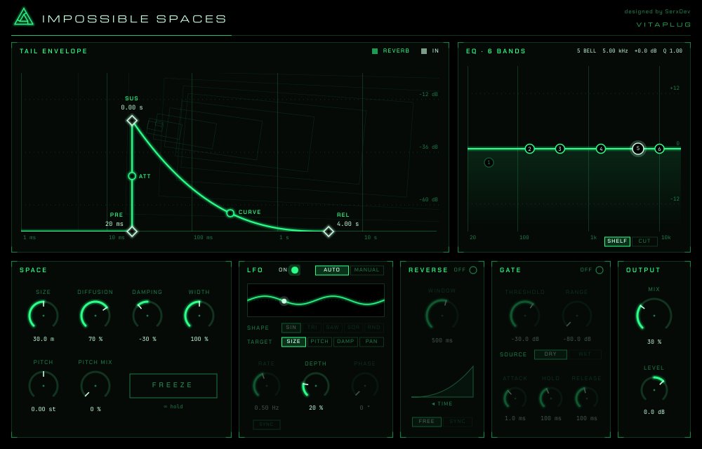

# IMPOSSIBLE SPACES

Reverb en formato **Audio Unit** para **Logic Pro**, basada en espacios que no pueden existir: salas de un kilómetro, colas que no decaen, que suben de tono a cada rebote o que ganan brillo con el tiempo.

*Marca: VitaPlug · Diseño: SerxDev*



> Captura real del plugin, tomada de la versión autónoma compilada en Linux y sin audio entrando (por eso la pantalla de señal está vacía).

---

## Índice

1. [Qué incluye](#qué-incluye)
2. [Estado del proyecto](#estado-del-proyecto)
3. [Instalación en Logic Pro](#instalación-en-logic-pro)
4. [Guía de uso](#guía-de-uso)
5. [Recetas](#recetas)
6. [Cómo funciona por dentro](#cómo-funciona-por-dentro)
7. [Proceso de desarrollo](#proceso-de-desarrollo)
8. [Compilar y probar](#compilar-y-probar)
9. [Validación en Logic: checklist](#validación-en-logic-checklist)
10. [Limitaciones conocidas](#limitaciones-conocidas)
11. [Licencias](#licencias)

---

## Qué incluye

| Pedido | Cómo está resuelto |
|---|---|
| Reverb de espacios imposibles | Un único motor muy paramétrico: red de 16 retardos realimentados (FDN) con tamaño de 1 m a 1 km, cola infinita, cambio de tono dentro del bucle y damping que puede oscurecer **o abrillantar** |
| Ecualizador de 6 bandas | Low-cut, low-shelf, 3 campanas y high-shelf conmutable a high-cut, con curva editable en pantalla |
| LFO auto o editable | **AUTO**: sincronizado al tempo y con profundidad que se retira cuando suena la fuente. **MANUAL**: forma, velocidad (Hz o tempo), profundidad y fase. Destino: Size, Pitch, Damping o Pan |
| Pantalla para editar pre-delay, sustain y release | Tres puntos arrastrables sobre la curva de la envolvente |
| Ver el impacto de la señal sobre la reverb | Historial en tiempo real del nivel de entrada (barras) y de la reverb (área) detrás de la envolvente |
| Inversor | Reverb inversa en tiempo real, con ventana libre o sincronizada al tempo y latencia compensada |
| Puerta de ruido | Para reverbs gateadas: detecta desde la señal seca (el gated clásico) o desde la propia cola |

## Estado del proyecto

Qué está comprobado y qué no, sin adornos:

| Aspecto | Estado |
|---|---|
| Motor DSP | Verificado con 58 tests automáticos (estabilidad, tiempos de caída, EQ, inversión, puerta, automatización brusca, varias frecuencias de muestreo) |
| Compilación del plugin | Verificada en Linux (versión autónoma) y en GitHub Actions sobre macOS (AU universal) — ver la pestaña *Actions* |
| Validación `auval` | La ejecuta GitHub Actions en cada push |
| Carga y uso en Logic Pro | **Pendiente**: requiere un Mac con Logic. Ver la [checklist](#validación-en-logic-checklist) |
| Calidad sonora | **Sin validar por escucha.** El desarrollo se hizo sin poder oír el resultado; el ajuste fino del sonido necesita una ronda de escucha |

## Instalación en Logic Pro

### 1. Descargar

En GitHub: pestaña **Actions** → último run en verde del workflow **build** → sección *Artifacts* → **ImpossibleSpaces-AU**. Descomprime hasta obtener `Impossible Spaces.component`.

(O compílalo tú: ver [Compilar y probar](#compilar-y-probar).)

### 2. Instalar

```bash
mkdir -p ~/Library/Audio/Plug-Ins/Components
cp -R "Impossible Spaces.component" ~/Library/Audio/Plug-Ins/Components/
```

### 3. Quitar la cuarentena

El plugin no está firmado con un certificado de Apple, así que macOS lo bloquea al venir de una descarga:

```bash
xattr -dr com.apple.quarantine ~/Library/Audio/Plug-Ins/Components/"Impossible Spaces.component"
```

### 4. Validar

```bash
killall -9 AudioComponentRegistrar 2>/dev/null
auval -v aufx ImSp Vita
```

Debe terminar con `AU VALIDATION SUCCEEDED`.

### 5. Cargar en Logic

Abre Logic. Si no aparece: **Logic Pro → Ajustes → Gestor de plug-ins**, busca *Impossible Spaces* y pulsa **Restablecer y volver a explorar la selección**.

Lo encontrarás en una pista de audio o auxiliar, en **Audio FX → Audio Units → VitaPlug → Impossible Spaces**.

## Guía de uso

### Pantalla TAIL ENVELOPE

El eje horizontal es tiempo en escala logarítmica (de 1 ms a 80 s). La línea brillante es la forma que tendrá la cola; los tres rombos se arrastran en horizontal:

| Punto | Parámetro | Rango | Qué hace |
|---|---|---|---|
| **PRE** | Pre-Delay | 0–500 ms | Silencio entre la señal y el arranque de la reverb |
| **SUS** | Sustain | 0–10 s | Tiempo que la cola se mantiene a nivel pleno, sin decaer, después de que calla la fuente |
| **REL** | Release | 0,1–60 s | Tiempo de caída (RT60). **Doble clic** en el rombo = cola infinita |

Detrás de la curva se ve la señal en tiempo real, desplazándose de derecha a izquierda (unos 5 segundos de historia):

- **Barras claras**: nivel de entrada.
- **Área verde**: nivel de la reverb.
- **Línea discontinua lima**: umbral de la puerta (solo con la puerta activada). El testigo **GATE** se enciende cuando está abierta.

La escala vertical de la señal va de 0 a −72 dB. Ojo: la envolvente usa el eje de tiempo logarítmico y la señal en vivo un eje lineal; comparten pantalla, no escala.

### Pantalla EQ

Ecualiza solo la reverb, no la señal seca.

| Banda | Tipo | Por defecto |
|---|---|---|
| 1 | Low-cut 12 dB/oct | 40 Hz, apagada |
| 2 | Low-shelf | 150 Hz |
| 3, 4, 5 | Campana | 400 Hz, 1,5 kHz, 5 kHz |
| 6 | High-shelf o high-cut (selector **SHELF / CUT**) | 10 kHz |

- **Arrastrar** un nodo: frecuencia (20 Hz–20 kHz) y ganancia (±18 dB). Los filtros de corte solo se mueven en frecuencia.
- **Rueda** sobre un nodo: Q (0,1–10).
- **Doble clic**: enciende o apaga la banda.

### SPACE

| Control | Rango | Por defecto | Qué hace |
|---|---|---|---|
| **SIZE** | 1–1000 m | 30 m | Tamaño del espacio. Moverlo mientras suena produce un efecto Doppler |
| **DIFFUSION** | 0–100 % | 70 % | Densidad del arranque: bajo = ecos sueltos, alto = nube |
| **DAMPING** | −100…+100 % | −30 % | Negativo: la cola se oscurece. Positivo: se abrillanta a cada rebote (imposible en una sala real) |
| **WIDTH** | 0–200 % | 100 % | Anchura estéreo; 0 = mono |
| **PITCH** | ±12 semitonos | 0 | Cambio de tono dentro de la realimentación: la cola sube o baja un poco más en cada vuelta |
| **PITCH MIX** | 0–100 % | 0 % | Cuánta realimentación pasa por el cambio de tono. A 0, PITCH no hace nada |
| **FREEZE** | on/off | off | Congela lo que haya dentro: deja de entrar señal y nada decae |

### LFO

| Control | Qué hace |
|---|---|
| **AUTO / MANUAL** | AUTO: seno de un compás, sincronizado al tempo; se retira cuando suena la fuente (por encima de −12 dBFS desaparece) y vuelve en las colas. MANUAL: tú decides todo |
| **SHAPE** | Seno, triángulo, sierra, cuadrada, aleatoria (solo MANUAL) |
| **TARGET** | Destino: SIZE (±50 %), PITCH (±2 semitonos), DAMP (±50 %) o PAN (de lado a lado) — valores a profundidad máxima |
| **RATE** | 0,01–20 Hz. Con **SYNC**, de 8 compases a 1/32 |
| **DEPTH** | 0–100 % (20 % por defecto) |
| **PHASE** | 0–360°, punto de arranque de la onda (solo MANUAL) |

Para que TARGET = PITCH se oiga, PITCH MIX debe ser mayor que 0.

### REVERSE

Reproduce la reverb al revés por tramos: en vez de apagarse, cada tramo crece.

| Control | Qué hace |
|---|---|
| **ON/OFF** | Activa el inversor |
| **WINDOW** | Longitud del tramo, 50 ms–2 s. Con **SYNC**, de 1/32 a lo que quepa en 2 s según el tempo |

Activarlo introduce una latencia igual a la ventana. El plugin se la declara a Logic, que la compensa, y retrasa la señal seca lo mismo para que siga alineada.

### GATE

| Control | Rango | Por defecto | Qué hace |
|---|---|---|---|
| **THRESHOLD** | −80…0 dB | −30 dB | Nivel por encima del cual la puerta se abre |
| **RANGE** | −80…0 dB | −80 dB | Cuánto atenúa cerrada. A 0 dB no hace nada |
| **SOURCE** | DRY / WET | DRY | DRY: manda la señal original (la reverb se corta cuando calla la fuente). WET: manda la propia reverb |
| **ATTACK** | 0,1–100 ms | 1 ms | Velocidad de apertura |
| **HOLD** | 0–2000 ms | 100 ms | Tiempo que sigue abierta tras caer bajo el umbral |
| **RELEASE** | 5–2000 ms | 100 ms | Velocidad de cierre |

### OUTPUT

| Control | Rango | Por defecto |
|---|---|---|
| **MIX** | 0–100 % | 30 %. En un envío auxiliar, ponlo al 100 % |
| **LEVEL** | −24…+12 dB | 0 dB |

Todos los controles vuelven a su valor por defecto con doble clic, y todos son automatizables.

## Recetas

Puntos de partida, no verdades absolutas (recuerda: están sin escuchar).

| Efecto | Ajustes |
|---|---|
| **Catedral infinita** | SIZE 150 m · DAMPING −20 % · REL: doble clic (∞) · MIX a gusto. Cada nota se suma a las anteriores |
| **Shimmer ascendente** | PITCH +12 · PITCH MIX 30–50 % · REL 8 s · DAMPING −40 % |
| **Abismo** | PITCH −5 · PITCH MIX 60 % · SIZE 300 m · DAMPING −60 % |
| **Reverb inversa** | REVERSE ON · WINDOW SYNC 1/4 · REL 1,5 s · MIX 100 % en un auxiliar |
| **Gated de los 80** | GATE ON · SOURCE DRY · THRESHOLD ajustado a la caja · HOLD 150 ms · RELEASE 30 ms · SIZE 40 m · REL 3 s |
| **Sala que respira** | LFO MANUAL · TARGET SIZE · RATE 0,1 Hz · DEPTH 60 % |
| **Muro de sustain** | SUS 4 s · REL 0,5 s: la cola se queda clavada 4 segundos y luego desaparece de golpe |
| **Cristal** | DAMPING +80 % · SIZE 8 m · DIFFUSION 30 % · REL 2 s |

## Cómo funciona por dentro

### Cadena de señal

```
Entrada ─┬─────────────────────────────────────────────────── seca ─┐
         └→ Pre-delay → Difusores → FDN 16 → Inversor → EQ → Puerta ─┴→ Mix → Salida
                                      ▲
                 envolvente (sustain/release) · LFO · detector de nivel
```

### Estructura del código

```
dsp/                 Motor en C++17 puro, sin JUCE. Se compila y prueba en cualquier sistema.
  DelayLine.h          Retardo circular con lectura entera e interpolada (Hermite)
  EnvelopeFollower.h   Detector de nivel
  PitchShifter.h       Cambio de tono granular
  Fdn.h/.cpp           Núcleo de la reverb
  TailEnvelope.h       Lógica de sustain
  Biquad.h, Eq6.h      Ecualizador
  Lfo.h                LFO
  Reverser.h           Inversor
  Gate.h               Puerta
  ReverbEngine.h/.cpp  Encadena todo; es lo único que usa el plugin
plugin/              Envoltorio JUCE
  Parameters.*         Los 71 parámetros y su paso al motor
  PluginProcessor.*    Audio, estado, latencia, tempo
  PluginEditor.*       Ventana y distribución
  ui/                  Tema, diales, pantallas de envolvente, EQ y LFO
  assets/fonts/        Tipografías incrustadas
tests/               58 tests del DSP, sin dependencias externas
.github/workflows/   Compilación y validación automáticas
docs/                Spec de diseño y plan de implementación
```

### El núcleo: FDN de 16 líneas

Una *Feedback Delay Network* son varios retardos cuyas salidas se mezclan entre sí y vuelven a entrar. Con retardos de longitudes irregulares y una mezcla sin pérdidas, los ecos se multiplican hasta formar una cola densa.

- **16 líneas de retardo** con longitudes repartidas de forma irregular entre el 35 % y el 100 % de `Size / 343 m/s`. A 30 m, la más larga mide 87 ms; a 1000 m, 2,9 s.
- **Matriz de Hadamard** 16×16 para la mezcla: reparte cada línea por igual entre todas las demás sin perder ni ganar energía, y se calcula con 64 sumas.
- **Ganancia por línea** calculada para que la caída total sea de 60 dB en el tiempo de Release: `g = 10^(−3 · T_línea / RT60)`.
- **Difusores**: 4 filtros pasa-todo en serie por canal antes de la red, para que un golpe seco no suene a ecos sueltos.
- **Salida estéreo**: las líneas pares van a la izquierda y las impares a la derecha, con signos alternos, lo que da dos canales decorrelados.

Lo "imposible" está en lo que pasa dentro del bucle:

- **Damping bipolar.** En negativo es un paso bajo (de 20 kHz a 500 Hz): cada rebote pierde agudos, como en una sala real. En positivo **suma** agudos en cada vuelta (hasta +3 dB), algo que ningún material puede hacer.
- **Cambio de tono en la realimentación.** Cuatro de las 16 líneas llevan un desplazador de tono. Como la señal da vueltas, cada pasada la desplaza otra vez: la cola sube o baja sin fin.
- **Saturador.** Con realimentación igual o mayor que 1 la energía crecería sin límite. Un limitador suave en cada línea lo impide; por debajo de cierto nivel es totalmente lineal, para que una cola sostenida no pierda nada.

### Sustain y release

`TailEnvelope` vigila la entrada. Mientras hay señal (por encima de −50 dBFS) y durante el tiempo de **Sustain** después, sube la realimentación de la FDN a exactamente 1 y desactiva el damping: la cola no pierde energía. Al terminar, la realimentación vuelve al valor que da el RT60 de **Release**, con una transición de 50 ms.

Consecuencia a tener en cuenta: durante el sustain, si la fuente sigue sonando, la energía **se acumula**. Es el comportamiento buscado (un espacio que no deja escapar el sonido), y el saturador lo mantiene acotado, pero con sustain largo y material denso la reverb crece mucho.

### Cambio de tono

Granular, con dos cabezales de lectura sobre un retardo de 60 ms. Cada uno se desplaza a velocidad distinta de la de escritura (eso cambia el tono) y, cuando llega al final, salta al principio. Para tapar el salto, cada cabezal lleva una ventana que lo silencia justo en ese momento, y el otro, desfasado media vuelta, cubre el hueco.

### Ecualizador

Seis filtros bicuadráticos en serie con las fórmulas clásicas de Robert Bristow-Johnson. La curva que ves en pantalla se calcula con esas mismas fórmulas, así que dibujo y sonido coinciden.

### LFO

Un oscilador lento con cinco formas. En modo AUTO su profundidad se multiplica por `1 − nivel de entrada`: con la fuente sonando fuerte no modula, y al callar la fuente aparece el movimiento en la cola.

### Inversor

No se puede invertir el tiempo en directo, pero sí por tramos. El inversor guarda la reverb y la reproduce hacia atrás en "granos" de la longitud de la ventana. Dos granos solapados a la mitad, cada uno con una ventana suave, evitan clics en las uniones. El precio es la latencia: hay que esperar a tener el tramo para poder darle la vuelta.

### Puerta

Una máquina de estados sencilla: abre al superar el umbral, espera el tiempo de *hold* al caer por debajo y luego cierra. Tiene 3 dB de histéresis para no castañetear con señales que rondan el umbral. Con fuente DRY escucha la señal original, no la reverb: por eso la cola se corta en seco al callar la caja aunque a la reverb le quedasen segundos.

### Seguridad del hilo de audio

Durante el proceso no se reserva memoria, no se bloquea y no se hace entrada/salida: todos los búferes se crean al preparar el plugin. La interfaz recibe los niveles por una cola sin bloqueo. La salida está acotada para cualquier combinación de parámetros.

## Proceso de desarrollo

### 1. Definición

Partiendo de la petición original se tomaron estas decisiones:

| Decisión | Elegido | Descartado y por qué |
|---|---|---|
| Framework | JUCE 8 + CMake | AUv3 nativo en Swift: imposible de probar fuera de un Mac y con un proyecto Xcode frágil de mantener a mano |
| Compilación | GitHub Actions en macOS | Compilar solo en local: no habría verificación automática de que el AU compila y valida |
| Concepto | Un motor muy paramétrico | Varios "espacios" seleccionables: más rápido de usar, pero menos libre |
| Algoritmo | FDN de 16 líneas | *Plate* tipo Dattorro (suena a reverb convencional) y convolución (ni cola infinita ni tono en el bucle) |
| LFO AUTO | Sincronizado y dependiente del nivel | Modulación fija de fábrica; dibujar la forma de onda a mano |

El diseño completo está en [`docs/superpowers/specs/`](docs/superpowers/specs/2026-11-12-reverb-espacios-imposibles-design.md) y el plan de tareas en [`docs/superpowers/plans/`](docs/superpowers/plans/2026-11-12-reverb-espacios-imposibles.md).

### 2. Condicionante principal

El desarrollo se hizo en un contenedor Linux: sin macOS, sin Logic y sin altavoces. De ahí la arquitectura en dos capas. El DSP no depende de JUCE ni de Apple, así que se pudo probar entero en Linux; el envoltorio del plugin es fino y lo verifica la integración continua en un Mac real.

### 3. Construcción con tests primero

Cada bloque se escribió así: primero el test, comprobar que falla, luego el código, comprobar que pasa. Orden: retardos → cambio de tono → FDN → envolvente → EQ → LFO → inversor → puerta → motor completo → plugin → interfaz → CI.

Qué miden los tests más relevantes:

- **Tiempo de caída**: se mide el RT60 real de la respuesta al impulso y se compara con Release (0,5, 2 y 8 s; tolerancia ±20 %).
- **Sustain**: el nivel a 1,5 s es el mismo que a 0,5 s, y a los 4 s ha caído más de 40 dB.
- **Estabilidad**: 10 s de ruido a 0 dBFS con cada combinación extrema de tamaño, damping y tono; y 20 s cambiando *todos* los parámetros al azar en cada bloque. Nunca un valor no finito ni fuera de rango.
- **Silencio**: tras la cola, la salida llega a cero exacto (sin denormales que disparen la CPU).
- **Independencia del tamaño de bloque**: el mismo audio procesado en bloques de 1, 64, 480 o tamaños aleatorios da el mismo resultado.
- **Frecuencias de muestreo**: a 44,1, 96 y 192 kHz los tiempos se mantienen en segundos.
- **Host sin tempo**: con tempo 0 o negativo se usan 120 BPM.
- **EQ**: la ganancia medida con senos coincide con la configurada y con la curva dibujada.
- **Inversión**: un golpe que decae sale como un golpe que crece.
- **Gated**: con la puerta, la reverb queda 60 dB por debajo a los 500 ms; sin ella, sigue sonando.

### 4. Problemas encontrados y cómo se resolvieron

- **El primer test del inversor estaba mal planteado.** Pedía que una rampa saliese invertida, pero con dos granos solapados eso no se cumple ni en un inversor correcto. Se sustituyó por uno que mide dónde queda la energía respecto al pico.
- **El inversor sonaba 1,6 dB bajo.** Dos granos que leen momentos distintos no suman en amplitud sino en potencia. Se compensó con una ganancia fija.
- **El freeze dejaba pasar algo de entrada** durante su fundido. Se acortó el fundido.
- **La puerta cerraba tarde** porque compartía detector con la envolvente (lento). Ahora tiene uno propio, más rápido.
- **Una cola sostenida seguía oscureciéndose** por el damping. Ahora el sustain y el freeze lo desactivan.
- **La interpolación de los retardos restaba agudos** en cada vuelta, lo que impedía una cola realmente infinita. Ahora los retardos son de longitud entera cuando el tamaño está quieto y solo se interpolan mientras se mueve.
- **El primer run de CI se canceló** al instante: la etiqueta `macos-14` ya no tenía runner. Se cambió a `macos-latest`.

### 5. Interfaz

Se presentó una maqueta antes de programar nada, con las condiciones dadas: negro y verde, estética futurista, el nombre arriba a la izquierda y los créditos discretos arriba a la derecha. Aprobada la maqueta, se implementó con primitivas de dibujo de JUCE, sin imágenes. El fondo de la pantalla principal es un corredor en perspectiva cuyo punto de fuga se desplaza con Size y el LFO; el símbolo es un triángulo de Penrose.

## Compilar y probar

### Tests del DSP (Linux o macOS, sin JUCE)

```bash
cmake -B build -DEI_BUILD_PLUGIN=OFF
cmake --build build
ctest --test-dir build --output-on-failure
```

### Plugin en macOS

Requisitos: Xcode y CMake 3.22 o superior (`brew install cmake`). JUCE se descarga solo.

```bash
cmake -B build -G Xcode -DCMAKE_OSX_ARCHITECTURES="arm64;x86_64" -DCMAKE_OSX_DEPLOYMENT_TARGET=11.0
cmake --build build --config Release
```

Al terminar, el `.component` se copia automáticamente a `~/Library/Audio/Plug-Ins/Components/`. También se genera una aplicación autónoma (`Impossible Spaces.app`) para probar sin Logic.

### Integración continua

El workflow [`build.yml`](.github/workflows/build.yml) se ejecuta en cada push:

1. **dsp-tests** (Ubuntu): compila y pasa los 58 tests.
2. **macos-au** (macOS): compila el AU universal (Apple Silicon + Intel), repite los tests, comprueba las arquitecturas, firma ad-hoc, instala, ejecuta `auval -v aufx ImSp Vita` y publica `ImpossibleSpaces-AU.zip` y `ImpossibleSpaces-Standalone.zip`.

### Identidad del plugin

| | |
|---|---|
| Nombre | Impossible Spaces |
| Fabricante | VitaPlug (`Vita`) |
| Código | `ImSp` |
| Tipo | `aufx` (efecto) |
| Bundle ID | `com.vitaplug.impossiblespaces` |
| Entrada / salida | Estéreo → estéreo, o mono → estéreo |

## Validación en Logic: checklist

- [ ] `auval -v aufx ImSp Vita` termina con `AU VALIDATION SUCCEEDED`
- [ ] Aparece en *Audio Units → VitaPlug → Impossible Spaces* y carga en una pista estéreo
- [ ] Carga también en una pista mono (como mono → estéreo)
- [ ] Suena con los valores por defecto
- [ ] La pantalla muestra la entrada y la reverb moviéndose
- [ ] Arrastrar PRE, SUS y REL cambia el sonido; doble clic en REL da cola infinita
- [ ] El EQ se oye y la curva corresponde
- [ ] LFO en AUTO y en MANUAL, con los cuatro destinos
- [ ] REVERSE: suena invertido y la señal seca sigue a tempo
- [ ] GATE con fuente DRY sobre una caja: la cola se corta
- [ ] FREEZE mantiene el sonido
- [ ] Automatizar un parámetro funciona en reproducción
- [ ] Guardar, cerrar y reabrir el proyecto conserva los ajustes
- [ ] Un *bounce* offline sale igual que en tiempo real
- [ ] El consumo de CPU es razonable con varias instancias

## Limitaciones conocidas

- **Sonido sin validar por escucha.** Lo más probable es que haga falta retocar constantes: densidad de la cola, carácter del cambio de tono, respuesta del damping positivo.
- **El cambio de tono es granular**: con material muy tonal y sostenido puede oírse un ligero trémolo a 60 ms.
- **Solo 4 de las 16 líneas** llevan cambio de tono, por coste de CPU.
- **Cambiar WINDOW con el inversor en marcha** puede producir un clic en la señal seca, y la nueva longitud tarda hasta una ventana en aplicarse.
- **Activar o desactivar REVERSE cambia la latencia** del plugin; Logic puede tardar un instante en recompensar.
- **Con sustain largo y entrada continua la reverb se acumula** hasta el limitador interno. Es intencionado, pero conviene vigilar el nivel.
- **Memoria**: unos 17 MB por instancia a 48 kHz y unos 67 MB a 192 kHz, por los retardos de hasta 3 s.
- **Sin presets de fábrica**, sin VST3/AAX, sin entrada de sidechain externa y con ventana de tamaño fijo (1000×640).
- **Sin firmar ni notarizar**: hace falta el paso de la cuarentena.

## Licencias

- **JUCE 8** se usa bajo su licencia AGPLv3 (o la licencia Starter gratuita de JUCE). Para uso personal no hay problema. Si algún día distribuyes el plugin, tendrás que publicar el código bajo AGPLv3 o adquirir la licencia de JUCE que corresponda. **Este repositorio aún no tiene un archivo de licencia propio**: es una decisión pendiente del autor.
- **Tipografías** incrustadas, todas bajo SIL Open Font License 1.1 (textos en `plugin/assets/fonts/`): Michroma, Chakra Petch y JetBrains Mono.
